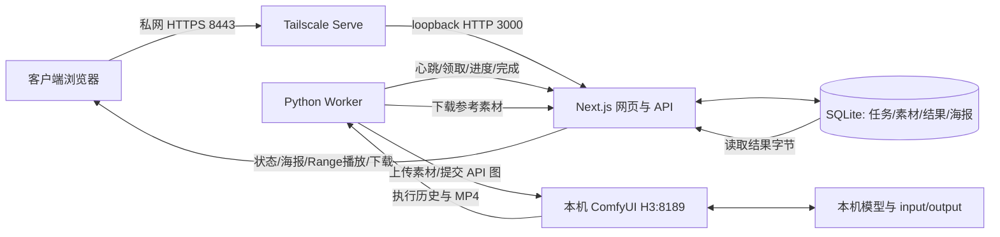
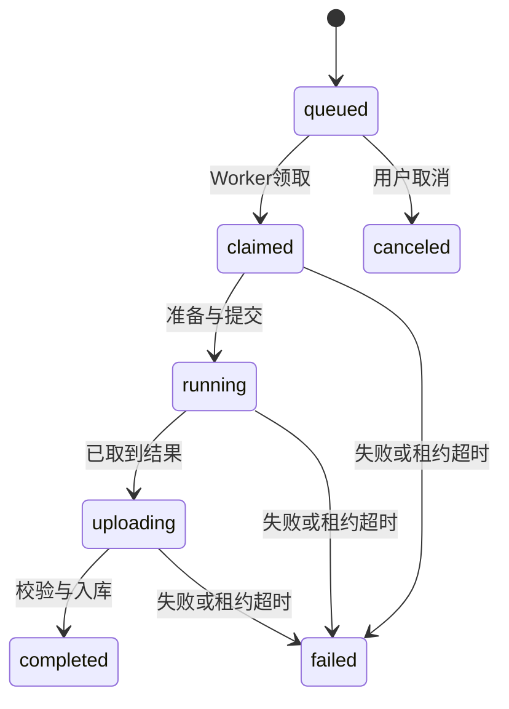

# 项目进度与运行逻辑

更新：2026-10-28（Asia/Taipei）。面向后续开发人员。运行逻辑以已部署的 `v1.0.0` 为准，开发候选单独说明。
本文不含生产令牌、真实私网域名、数据库内容或机器私有路径；现场位置与状态见用户保留的私有交接记录。

## 1. 项目是什么

这是部署在 Windows GPU 主机上的个人私网视频工作台。浏览器提交参数和参考素材，网页持久保存队列，独立 Python Worker 调用同机 ComfyUI MiniMax H3，结果经验证后回存网页供播放下载。
网页、队列、Worker和H3均在生成主机，新视频素材与结果不经过旧Mac。
核心入口是全能参考、文生视频、首尾帧生视频。当前是个人私网系统，尚未实现完整的公网多租户账号隔离、计费和授权。

## 2. 当前进度

### 已完成并部署的1.0

| 项目 | 状态 |
| --- | --- |
| Windows独立网页与Worker环境 | 已完成，与ComfyUI Python环境分开 |
| 私网访问 | HTTPS 8443，原有443服务保留 |
| H3连接 | 本机 `http://127.0.0.1:8189` |
| 三个核心模式 | 原生H3 API模板，已完成真实生成 |
| 图片/视频/音频参考 | 上传、角色/编号校验、解码归一化和受控接线 |
| 参数 | 三种比例、360/576/720档、4–15秒、seed、12/20/30步及声音选项 |
| 队列 | 上限500个未结束任务，并发1 |
| 输出 | MP4验证、尺寸裁剪、音轨、海报、Range、播放与下载 |
| 持久恢复 | 数据库任务、Worker journal、提交意图和prompt ID |
| 历史迁移 | 已备份并迁入历史快照，后续记录继续本机保存 |
| Mac图片生成 | 新任务已关闭，历史图片仍可用 |
| 后台运行 | Windows计划任务分别管理网页和Worker，独立于Codex/终端 |
| Git基线 | `v1.0.0`、GitHub源码和本地bundle已建立 |

### 已提交的应用候选

远程 `codex/director-app` 已发布 `b640d4a0effa0c052a80abc339585c0fb2d3f9d7`，属于候选，尚未部署到生成主机。
其 [DIRECTOR-APP-HANDOFF.md](https://github.com/wangge666666/minimaxh3/blob/b640d4a0effa0c052a80abc339585c0fb2d3f9d7/DIRECTOR-APP-HANDOFF.md) 记录：

- 三种模式增加native/director选择和就绪状态，切换时保留参数与文件。
- 服务端固定engine、模板修订和输出节点ID，保存在现有 `jobs.params` JSON中，无新增SQL表结构迁移。
- Worker新增调度元信息校验；恢复已有prompt时使用原输出ID，不因今天的能力或模板改变而重做GPU任务。
- 支持测试数据库/端口/工作流目录配置，新增一致备份辅助脚本。
- Director仍被明确拦截，不能仅因能力表文件出现就启用。
- 对方报告：TypeScript75项、Python133项、typecheck、Ruff、build通过，完成隔离网页/HTTP测试。

这些是该候选的交付记录，本轮只阅读了源码和交接，没有在生成主机复跑这些检查，不能当作Windows/GPU或生产部署通过。

### 工作流开发中

本次本机检查发现未提交草稿：三套Director API/mapping、mapping适配、`director_workflow.py`、`director_runtime.py`、对应测试、插件清单/运行包及 `h3_capabilities.json`。
草稿能力表将Director标为candidate，三个模式均为 `available: false`、验证pending。其存在不代表接口冻结或验收通过。
工作流分支远程已提交的最新版本仍是协作说明 `533c8d8`，上述草稿尚未发布。
当前生产8189尚未加载Director，8188可见Director节点。生产网页仍使用原生H3。
待完成：工作流交付、插件最小加载、三模式GPU验收、能力/版本契约对齐、应用联调和协调发布；加速、多镜头等后续单独增量。

## 3. 版本与分工

| 标识 | 含义 |
| --- | --- |
| `main` / `v1.0.0` / `codex/baseline-v1.0` | 生产源码基线 `318b0caa5a941b56e2a49e3f6b6e0e79ad017090` |
| `codex/director-workflows` | ComfyUI图、mapping、素材接线、工作流构造/测试和GPU验收 |
| `codex/director-app` | 网页、API、数据库、队列、Worker调度/恢复、应用测试 |
| `codex/project-overview` | 本说明文档分支，无生产功能改动 |

`v1.0.0`是网页/Worker项目版本，不是MiniMax模型或ComfyUI版本。
模型身份、依赖与工作流哈希见 [docs/baselines/v1.0.0.json](docs/baselines/v1.0.0.json)。职责与接口约定见 [COLLABORATION-DIRECTOR.md](COLLABORATION-DIRECTOR.md)。
开发人员进入目录先检查Git状态；不能覆盖其他会话的未提交草稿，不能用整个目录复制代替按明确SHA整合。

## 4. 整体架构



网页、Worker、ComfyUI是三个独立进程。浏览器只调用网页，Worker主动领取，ComfyUI负责GPU推理。
网页不直接进行GPU推理，ComfyUI不管理网页SQLite队列。
Tailscale直连或DERP影响客户端上传/下载；本机H3生成时间需要单独计量。

## 5. 一条任务的完整生命周期

1. **选择与提交。** `studio.tsx`维护模式/参数/文件，生成本次requestId和seed，将params及素材组成multipart FormData。
2. **上传进度与恢复。** `client.ts`使用XHR展示上传进度。同次提交重试沿用requestId，先查询是否已入库，避免响应丢失导致重复入队。
3. **校验。** API检查Host/Origin和严格Zod参数，限制请求体及素材类型/大小/角色。图片用Sharp解码、转正、缩放为PNG；视频/音频在这里先检查容器，Worker稍后实际解码。
4. **原子入队。** `JobStore.create()`在SQLite写事务中核对request_id唯一性和500上限，将参数与素材写入数据库，状态queued。
5. **领取。** Worker报告健康和可执行模式；服务端按时间/rowid领取最早的可执行任务，分配90秒lease，在事务中防止第二个执行任务。
6. **恢复记录。** Worker将任务写入本机journal，预检固定图和节点；浏览器不能提交任意图/节点/模型路径。
7. **准备素材。** Worker带租约读取素材，实际解码/归一化后上传至ComfyUI的hub输入子目录，再把返回路径接到受控conditioning输入。
8. **构造与提交。** `mapping.py`读取API JSON及mapping，填入参数和素材接线。先将submission_pending写入journal，再向ComfyUI `/prompt` 提交。
9. **等待。** prompt_id写入journal和数据库。WebSocket提供节点/采样进度，`/history/{prompt_id}`核对完成和输出；Worker持续续租，网页约每2.5秒取state。
10. **验证导出。** 从指定输出节点取一个持久化MP4，检查编码、尺寸、帧数、时长、音轨和完整解码；必要时裁剪、静音或faststart，提取海报。
11. **回存。** Worker通过complete上传结果和可用海报，API核对lease/状态/媒体并写入SQLite，状态completed；Worker清理journal。
12. **播放下载。** 网页媒体接口读取SQLite结果BLOB，提供缓存和字节范围响应；无需客户端直接连接ComfyUI或Mac。

## 6. 状态机与队列规则



- 500上限是 `queued + claimed + running + uploading`总数；一个执行任务占用其中一个名额。
- Worker和数据库均限制并发1，配置字段允许的数值上界不代表runner支持并行。
- Worker只领取它报告可执行的模式；同模式顺序按created_at，时间相同用rowid。
- 取消只支持queued，不是中断GPU计算的接口。
- state返回全部未结束任务和最近50条终态历史；更老历史仍在数据库，当前页面不是完整历史浏览器。
- Worker心跳约15秒内有效；任务lease为90秒，通过任务progress续期，普通心跳不代表任务无限续租。
- H3在线检查只证明system_stats可访问，不证明Director或每个模型/图已可执行。

## 7. 防重复与恢复边界

系统采用保守防重复策略，不承诺任意崩溃与无限离线下的“恰好一次”GPU执行。

- requestId解决同次提交重复入队；job id标识网页任务；prompt_id标识Comfy执行；lease证明本次领取所有权。
- journal通过临时文件、fsync和原子替换保存；状态目录有进程锁。
- `/prompt`不自动重试。响应丢失时从队列/最近历史的 `extra_data.hub_job_id`查找原提交。
- 找不到或发现多个提交就停止核对，不盲目补交。Comfy历史及搜索窗口有限。
- 已有prompt_id继续跟踪原执行；uploading恢复只重新取结果、验证、回传，不重新生成。
- complete对原已完成任务/租约可安全重试；claim不做可能领取第二条的自动重试。
- 网络错误保留journal；若离线超过lease而服务端已标failed，可能需要人工核对Comfy历史。
- state/领取等操作会触发过期检查。应用failed不等于GPU一定没有产出文件。
- 应用候选进一步固定输出ID、先处理pending提交再组图，并保留旧journal兼容；该候选仍需集成验收。

## 8. 数据模型和存储归属

SQLite位于网页cwd下 `.local-data/mvp.sqlite`，使用WAL。

| 表/字段 | 内容 |
| --- | --- |
| jobs.id / request_id | 网页任务ID、幂等提交ID |
| jobs.params | mode、prompt、尺寸、帧数、seed及选项的JSON字符串；mode不是独立SQL列 |
| jobs.status / timestamps / message | 生命周期和显示信息 |
| jobs.prompt_id / worker_id / lease / lease_until | Comfy执行关联和领取租约 |
| jobs.input | 旧单参考图兼容BLOB |
| jobs.output / poster | 最终媒体和海报BLOB |
| job_assets | 每个job/key的kind、name、mime、data BLOB |
| worker | 心跳与后端健康 |

ComfyUI input/output另有生成端文件，Worker journal另存本机。**网页参考素材和最终结果保存在SQLite，不是只保存在ComfyUI输出目录。**
因此只备份output不能恢复网页；Git也不包含数据库、上传素材、结果、令牌或journal。
一致备份用SQLite backup API或正确的离线/WAL处理，不能只复制运行中的主sqlite文件。
按mode统计应使用 `json_extract(params, '$.mode')`。

## 9. API地图（生产1.0）

MVP接口集中在 `apps/web/src/app/api/mvp/[[...path]]/route.ts`。

| 方法与路径 | 作用 |
| --- | --- |
| GET /api/health | 网页进程健康 |
| GET /api/mvp/state | 状态、队列、Worker健康、功能开关 |
| POST /api/mvp/jobs | multipart参数与素材，幂等创建 |
| GET /api/mvp/jobs/request/{requestId} | 查询提交是否入库 |
| POST /api/mvp/cancel | 取消queued |
| GET/HEAD /api/mvp/jobs/{id}/media | 播放/下载；image为兼容路径 |
| GET/HEAD /api/mvp/jobs/{id}/poster | 海报 |
| POST /api/mvp/worker/heartbeat | Worker后端健康 |
| POST /api/mvp/worker/claim | 领取任务 |
| GET /api/mvp/worker/input/{id}/{key} | 带lease获取指定素材；无key兼容旧单图 |
| POST /api/mvp/worker/progress | 状态、prompt_id、续租 |
| POST /api/mvp/worker/complete | 上传结果及可选海报 |

Worker接口用Bearer令牌，相关操作还校验lease；浏览器不持有Worker令牌。
浏览器依赖私网边界和Host/Origin检查，尚非完整账号权限体系。
媒体接口提供私有缓存、ETag、Content-Disposition和Range；显式download查询返回完整下载，当前页面下载链接复用播放URL并带download属性。

## 10. 模型、参数与素材契约

| mode | conditioning | 主模型 |
| --- | --- | --- |
| h3_t2v | MiniMaxH3ImageToVideo，不带帧参考 | FL2VA Pruned INT8 ConvRot |
| h3_i2v | MiniMaxH3ImageToVideo，首帧必需、尾帧可选 | FL2VA Pruned INT8 ConvRot |
| h3_r2v | MiniMaxH3ReferenceToVideo | REF2VA Pruned INT8 ConvRot |

共用Qwen3-VL32B NVFP4 AWQ、FP16视频VAE和FP32音频VAE。
原生1.0采样器/调度器为res_multistep/simple，质量验收20步，未启用Turbo/Sage/FastH3。

- 三比例16:9/9:16/1:1，360/576/720档，例如横屏640×360、1024×576、1280×720。
- 采样宽高向上对齐32，Worker居中裁掉补齐边缘，输出精确用户尺寸。
- 4–15秒、24fps；帧数 `5 + 17 * ceil((ceil(seconds * 24 - 1e-9) - 5) / 17)`。请求5秒为124帧，约5.167秒。
- 4秒功能保留，但真实基线验收未覆盖该档；可选择不等于已实测。
- R2V最多9图/3视频/3音频，key从0开始连续，提示词Picture/Video/Audio从1开始引用；至少一项素材。
- T2V不带参考；I2V使用first_frame/last_frame。尾帧单独输入若新增，必须作为明确扩展，保留旧校验。
- 上传上限：单图8MiB、视频20MiB、音频10MiB，总计96MiB。
- 静态PNG/JPEG/WebP，服务端最多1600万像素、缩放至2048范围内；Worker按用途再处理。
- 参考视频2–15秒、音频0.1–15秒；视频还会按当前生成帧数对应时长截取。
- Worker归一化视频为最长边不超过768的24fps H.264，音轨/独立音频处理为双声道32kHz；参考视频音轨是否参与由选项控制。
- 上传成功、图中有节点不代表素材参与采样，必须追踪到被执行采样路径的连接。

必须成套审查：网页选项 → API schema/素材校验 → 队列params → Worker归一化 → mapping与固定图 → Comfy节点 → 输出验证。

## 11. 代码导航

| 文件/目录 | 责任 |
| --- | --- |
| apps/web/src/components/studio.tsx | 创作、参数、轮询、提交、历史 |
| reference-picker.tsx / video-player.tsx | 素材交互、海报与播放 |
| apps/web/src/lib/mvp/client.ts | 请求、XHR上传和提交核对 |
| schema.ts / h3.ts / uploads.ts | 参数、帧数/尺寸/素材规则与解析 |
| store.ts / queue.ts | SQLite、事务、幂等、lease、上限、历史窗口 |
| access.ts / media.ts | 私网来源/Worker凭据、范围媒体响应 |
| apps/worker/src/comfy_hub_worker/config.py / __main__.py | 配置和命令入口 |
| runner.py | 单实例、journal、领取/恢复与执行编排 |
| mapping.py | 固定API模板与字段/素材接线 |
| comfy.py | 节点检查、上传、提交、历史核对、WebSocket、下载 |
| references.py / video.py | 素材归一化、输出解码/裁剪/声音/faststart和海报 |
| workflows/*_api.json / *_mapping.json | 执行图与字段类型/范围 |
| scripts/windows | 后台任务、启停保护、迁移、基线检查 |
| packages/shared | 共享状态/类型；部分H3规则仍在网页和Python两侧维护 |

应用候选新增 `workflows.ts` / `workflow-options.ts`、Worker `workflow_dispatch.py` 和 `scripts/prepare-director-app.py`。
工作流草稿新增Director构造/runtime及能力表，需按明确SHA交付；不要把草稿路径当作生产已经可用。

## 12. 后台运行和隔离

计划任务分别运行网页和Worker，部署用户登录时触发，失败按设置重启。
网页cwd为apps/web，loopback3000；Worker cwd为apps/worker，独立venv。
启动器管理隐藏子进程、日志和进程记录。关闭终端/Codex后仍运行；当前不是未登录即可工作的系统服务。
ComfyUI独立管理，Hub启停不等于ComfyUI启停。

生产目录可用：

```powershell
.\scripts\windows\hub.ps1 status
.\scripts\windows\hub.ps1 logs
.\scripts\windows\hub.ps1 start
.\scripts\windows\hub.ps1 stop
```

正常stop有未结束任务会拒绝。任务边界暂停脚本另有部署前提，使用前阅读。
脚本带生产任务名，测试checkout不得直接install/start/stop它们。
各测试实例独立端口、数据库、令牌和状态目录；不复制生产journal，不领取生产队列。
1.0的来源校验不能任意换localhost端口；应用候选已增加明确配置项，需整合对应代码后使用。
相对数据库/工作流/状态路径依赖启动cwd，不能从任意目录启动后假定位置相同。

## 13. 历史验收和未验证项

- 1.0：TypeScript68项、Python109项，typecheck/Ruff/build通过；本轮未重跑。
- 三条真实1280×720、124帧/请求5秒/20步完成，Worker处理404.882、444.432、482.887秒。
- 另有640×360真实生成、声音、完整解码、海报、Range、播放下载验收。
- 远端Windows实际上传/播放与下载测速已有用户参与；网络直连证据只代表当时条件，不保证换网速度。
- 应用候选的75/133项等结果来自其交付记录，不等于Windows生产、Director或GPU通过。
- Director草稿、加速、多镜头、4秒和全部参数组合未因上述证据自动获得验收。
- 历史Director项目仍有随机字幕、跨人物引导串脸、口型/声音一致性限制，不能宣传已全部解决。

## 14. 接下来怎么开发、合并和回滚

1. 阅读本文、AGENTS、基线、工作流说明和协作分工，核对各分支与未提交文件。
2. 工作流侧交付三套Director图、构造适配、能力表、插件方案和实测；应用侧对接真实契约。
3. **先统一revision协议。** 应用候选native修订为API+mapping内容的 `native-sha256:`哈希（规范化CRLF为LF），不是简单的人类版本字符串；草稿能力表与构造器必须明确兼容，不能直接拼接上线。
4. 明确能力schema、可用/验收条件、旧版本文件保留、输出ID和缺版本行为；文件存在不代表可用，不能只删Director guard。
5. 旧任务缺字段默认native，新任务固定engine/revision/输出ID。已有prompt恢复不因今天的模板变化再次提交。
6. 少量串行GPU验证从640×360、124帧、20步开始，分别测三模式；R2V覆盖图/视频/音频独立及组合，保留原生入口。
7. 500容量边界使用隔离库，不灌生产任务。代码检查、构建、GPU和真实浏览器各自列出结果。
8. 生产切换统一协调，等正在运行任务自然结束，备份一致SQLite、配置与journal，保留素材和queued记录；不顺带换Torch/模型/网络。
9. **应用候选虽无SQL DDL，回滚仍需兼容。** 新jobs.params含engine/revision/输出快照，1.0严格completion schema不接受额外字段。不能以为单纯切回v1.0.0源码即可无损继续；需准备兼容构建或审查过的迁移。
10. 不恢复旧数据库抹掉新任务，不移动1.0标签。标准三模式稳定后再分别增加加速、多镜头、选择重做和导演包。

接手优先级：生产链路与数据保护 → 工作流/应用契约 → 三模式真实验收 → 回归与兼容回滚 → 后续功能。
